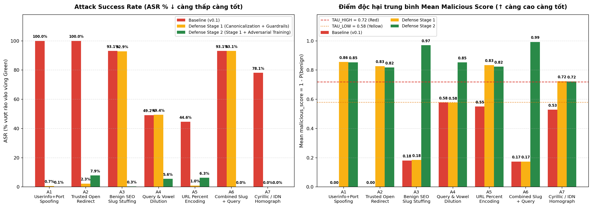

# Báo cáo: Kiểm thử Độ bền vững Đối kháng (Adversarial Testing) & Nâng cấp Phòng thủ Đa tầng (Adversarial Defense)

> Ghi lại ngày 23/11/2026 (bản sao lưu trạng thái trước nâng cấp tại `Backup/before_adversarial_defense_2026-11-23/Api/`).
> Toàn bộ thực nghiệm dưới đây được chạy trong notebook [src/adversarial_evaluation.ipynb](file:///d:/Study%20Assets/Final%20Project/PhishingGuard/src/adversarial_evaluation.ipynb) và đã được tích hợp trực tiếp vào [Api/features.py](file:///d:/Study%20Assets/Final%20Project/PhishingGuard/Api/features.py), [Api/phishing_api.py](file:///d:/Study%20Assets/Final%20Project/PhishingGuard/Api/phishing_api.py), [Api/deploy_bundle.pkl](file:///d:/Study%20Assets/Final%20Project/PhishingGuard/Api/deploy_bundle.pkl) và [Api/test_api.py](file:///d:/Study%20Assets/Final%20Project/PhishingGuard/Api/test_api.py).

---

## 1. Đặt vấn đề & Mô hình đe dọa (Problem-Space Threat Model)

Sau khi chuẩn hoá scheme/`www.` và tách `domain_hyphens` / `path_hyphens`, hệ thống **PhishingGuard** đạt độ chính xác cao trên dữ liệu tĩnh. Tuy nhiên, trong môi trường thực tế, kẻ tấn công chủ động biến đổi cấu trúc URL độc hại $u \rightarrow u'$ sao cho:
1. **Bảo toàn chức năng (Functional Equivalence):** URL $u'$ vẫn truy cập được đến trang lừa đảo thật trên trình duyệt.
2. **Qua mặt hệ thống (Evasion):** Vượt qua **Layer 1 (Tranco Whitelist eTLD+1)** để được gắn nhãn `whitelisted = True`, hoặc thao túng vector 27 đặc trưng của **Layer 2 (LightGBM)** nhằm kéo điểm độc hại $\text{malicious\_score} = 1 - P(\text{benign}) < \text{TAU\_LOW} = 0.58$ (rơi vào vùng `green`).

Để lượng hoá mức độ rủi ro, chúng ta đo chỉ số **ASR (Attack Success Rate % $\downarrow$)** trên tập **$N = 1.000$ URL Phishing thực tế** trích từ `Data/Holdout/merged_holdout.csv` (vốn đã bị bản Baseline bắt được $100\%$ ở trạng thái gốc với $\overline{s}_{\text{gốc}} = 0.8386$, gồm $721$ mẫu `red` và $279$ mẫu `yellow`).

---

## 2. Phát hiện 7 Lỗ hổng Đối kháng trên Bản Baseline (PhishingGuard v0.1)

Kết hợp kiểm thử hộp trắng mã nguồn (`Api/`) và giải thích cục bộ bằng SHAP (`TreeExplainer`), 7 kịch bản tấn công thực tế (**A1 – A7**) đã được xác định:

### 2.1 Nhóm tấn công khai thác bộ phân tích cú pháp, bảng mã Unicode/Punycode & các đặc trưng bị loại (A1, A2, A5, A7)
Trong [Models/final_features.json](file:///d:/Study%20Assets/Final%20Project/PhishingGuard/Models/final_features.json), 5 đặc trưng bị loại khỏi tập `k = 27` gồm: `num_at`, `num_percent`, `has_port`, `has_fragment`, `is_shortened_url`. Kẻ tấn công có thể khai thác trực tiếp khoảng trống này cùng cơ chế tên miền quốc tế hoá (IDN):

1. **A1 — Giả mạo `userinfo@` kèm `:port` (`http://facebook.com:80@evil.tk/login`):**
   - Bản cũ trích tên miền bằng `urlparse(u).netloc.split(':')[0]`. Khi có `:80@` đứng sau tên miền uy tín, hàm `.split(':')[0]` cắt ngay tại dấu `:` đầu tiên và trả về **`facebook.com`** thay vì `evil.tk`.
   - **Hệ quả:** $100\%$ URL độc hại dùng cú pháp này được **Layer 1 Whitelist cho qua (`malicious_score = 0.0000`)**.
2. **A2 — Lợi dụng Open Redirect trên tên miền uy tín (`https://www.google.com/url?q=http://evil.tk`):**
   - Layer 1 chỉ kiểm tra tên miền gốc của URL bao ngoài (`google.com`), dẫn đến $100\%$ link lừa đảo bọc trong tham số chuyển hướng được miễn kiểm tra ML.
3. **A5 — Mã hoá Percent-Encoding đường dẫn (`/login` $\rightarrow$ `/%6c%6f%67%69%6e`):**
   - Hàm `normalize_url` cũ chưa giải mã `%xx` (`unquote`), khiến `has_suspicious_word` tụt về `0` trong khi `num_percent` đã bị loại khỏi mô hình, làm **44,6%** mẫu Phishing thoát khỏi vùng cảnh báo.
4. **A7 — Tấn công Ký tự Đồng dạng Cyrillic & IDN Punycode Homograph (`http://pаypal.com/` $\leftrightarrow$ `http://xn--pypal-4ve.com/`):**
   - Kẻ tấn công thay chữ cái Latin bằng chữ cái hệ **Cyrillic** giống hệt về mặt thị giác (`а, е, і, о, р, с, у, х, ѕ...` trong dải Unicode `U+0400–U+04FF`).
   - Khi người dùng mở trên Chrome, trình duyệt tự động chuyển đổi tên miền sang chuẩn ASCII Punycode có tiền tố `xn--` (ví dụ `pаypal.com` $\rightarrow$ `xn--pypal-4ve.com`) trước khi gửi qua Chrome Extension.
   - Bản Baseline v0.1 không có bộ giải mã `idna` và không nhận diện ký tự Cyrillic: mô hình chỉ nhìn thấy một tên miền `.com` ngắn có 2 dấu `-` (`xn--`), chấm điểm `0.4645` (với chữ Cyrillic thô) và `0.5470` (với Punycode `xn--pypal-4ve.com`, thấp hơn `TAU_LOW = 0.58`), làm **78,1%** mẫu tấn công Homograph lọt vào vùng **`green`**.

### 2.2 Nhóm tấn công thao túng đặc trưng mô hình LightGBM được chỉ ra bởi SHAP (A3, A4, A6)
Phân rã đóng góp SHAP trên bản Baseline cho thấy mô hình cây quyết định bị phụ thuộc vào 2 "lá chắn lành tính":

```text
URL gốc : http://vietcombank-secure-verify.xyz/login/account
-> Dự đoán: RED (score = 0.8305)
   + SHAP đẩy về ĐỘC HẠI : [('is_suspicious_tld', 1.0, +1.002), ('domain_hyphens', 2.0, +0.303)]

URL A3  : http://vietcombank-secure-verify.xyz/login/account/tin-tuc-cong-nghe-cap-nhat-he-thong-bao-mat-moi-2026
-> Dự đoán: GREEN (score = 0.1412)  <-- Tụt 0.6893 điểm!
   - SHAP đẩy về LÀNH TÍNH: [('path_hyphens', 10.0, -2.418), ('path_length', 66.0, -0.492)]
```

5. **A3 — Nhồi đường dẫn kiểu bài báo (Benign SEO Slug Stuffing):** Vì `path_hyphens` là đặc trưng Top 1 của mô hình và mang ý nghĩa lành tính trên tập bài báo, việc nối thêm một slug có 8–10 dấu `-` tạo ra lực kéo SHAP âm **`-2.418`**, làm **93,1%** mẫu Phishing tụt thẳng về vùng `green` (điểm độc hại trung bình sụp đổ từ `0.8386` xuống `0.1810`).
6. **A4 — Pha loãng bằng tham số truy vấn & nguyên âm (`?page=home` / `&ref=aeiouaeiou`):** Đặc trưng `num_query_params = 1` có đóng góp SHAP âm (`-0.211` đến `-0.358`), giúp **49,2%** mẫu Phishing vượt ngưỡng an toàn.
7. **A6 — Kết hợp Slug + Query Camouflage:** Phối hợp đồng thời **A3** và **A4**, đẩy tỷ lệ vượt rào $\text{ASR}$ lên tới **93,1%** (điểm trung bình chỉ còn `0.1737`).

---

## 3. Thiết kế Phòng thủ Đối kháng 2 Giai đoạn (Đã tích hợp vào `Api/`)

### 3.1 Giai đoạn 1 (Stage 1 Defense): Chuẩn hoá Cú pháp, Nhận diện Cyrillic/Punycode & Gia cố Layer 1
Đã cập nhật trực tiếp trong [Api/features.py](file:///d:/Study%20Assets/Final%20Project/PhishingGuard/Api/features.py) và [Api/phishing_api.py](file:///d:/Study%20Assets/Final%20Project/PhishingGuard/Api/phishing_api.py):

- **Bóc tách Open Redirect (`extract_nested_redirect_url`) & Gỡ bỏ `userinfo@`:**
  ```python
  nested = extract_nested_redirect_url(u)
  if nested is not None:
      u = nested
  ...
  if '@' in authority:
      authority = authority.rsplit('@', 1)[-1]
  ```
- **Nhận diện & Giải mã Cyrillic / IDN Punycode (`decode_idn_hostname` & `has_idn_homograph`):**
  - Giải mã mọi nhãn tên miền bắt đầu bằng `xn--` về Unicode qua chuẩn `idna` (`label.encode('ascii').decode('idna')`).
  - Phát hiện chính xác cả 2 dạng: URL chứa trực tiếp ký tự Cyrillic/Non-ASCII (`http://pаypal.com/`) và URL dạng Punycode do Chrome gửi lên (`http://xn--pypal-4ve.com/`).
  - Tích hợp bảng ánh xạ đồng dạng `_HOMOGLYPH_LEET_MAP` (gồm các chữ cái Cyrillic/Greek đồng dạng `а->a, е->e, і->i, о->o, р->p, с->c, у->y, х->x, ѕ->s...` cùng chữ số Leetspeak `0->o, 1->i, 3->e, 4->a, 5->s`) vào `f_has_suspicious_word` để bắt cả `/lоgіn` viết bằng chữ Cyrillic lẫn `/l0g1n` viết bằng số.
- **Lấy tên miền chuẩn qua `.hostname` & Giải mã `%xx` đa tầng:** Dùng `_parse(url).hostname` (tự động loại bỏ cả `user:pass@` lẫn `:port`), giải mã `unquote(unquote(rest))` và gộp dấu `//` thừa trên đường dẫn trước khi tính 32 đặc trưng.
- **Hard Guardrail ở Layer 1 & Layer 2:** Từ chối whitelist mọi URL có `userinfo@`, Open Redirect hoặc Cyrillic/IDN Homograph; nếu URL dùng `userinfo@` hoặc Cyrillic/IDN Homograph, tự động ấn định nhãn `phishing` và nâng điểm độc hại tối thiểu bằng `TAU_HIGH = 0.72` (`red`).

### 3.2 Giai đoạn 2 (Stage 2 Defense): Huấn luyện Đối kháng trên Không gian Bài toán (Problem-Space Adversarial Retraining)
Để khắc phục triệt để lỗ hổng học máy ở **A3, A4, A6** (nơi Stage 1 không thể can thiệp vì URL hoàn toàn hợp lệ về cú pháp):
- Lấy $20.000$ mẫu `phishing` từ tập huấn luyện `Models/Train_Test/merged/train.csv` ($484.379$ mẫu), sinh tự động $3$ biến thể đối kháng cho mỗi URL (nhồi slug nhiều dấu `-`, thêm query pha loãng nguyên âm, và kết hợp cả hai) $\rightarrow$ thu được **$59.994$ mẫu Phishing đối kháng**.
- Huấn luyện lại mô hình LightGBM (`lgbm_stage2`) trên tập dữ liệu hợp nhất gồm **$544.373$ mẫu** và xuất ra [Api/deploy_bundle.pkl](file:///d:/Study%20Assets/Final%20Project/PhishingGuard/Api/deploy_bundle.pkl).

---

## 4. Kết quả Thực nghiệm & Đối chiếu Trước / Sau Phòng thủ

### 4.1 Hiệu quả chống tấn công đối kháng trên 1.000 URL Phishing (7.000 mẫu biến thể A1 – A7)

| Kịch bản tấn công ($N = 1.000$ mẫu / kịch bản) | Baseline (v0.1)<br>Mean Score ($\uparrow$) | Baseline (v0.1)<br>**ASR % ($\downarrow$)** | Defense Stage 1<br>Mean Score ($\uparrow$) | Defense Stage 1<br>**ASR % ($\downarrow$)** | Defense Stage 2<br>Mean Score ($\uparrow$) | Defense Stage 2<br>**ASR % ($\downarrow$)** |
|---|---|---|---|---|---|---|
| **A1:** `userinfo@` + `:port` Spoofing | `0.0000` | **100.0%** ⚠️ | `0.8557` | **0.7%** ✅ | `0.8532` | **0.1%** ✅ |
| **A2:** Trusted Open Redirect (`?q=`) | `0.0000` | **100.0%** ⚠️ | `0.8274` | **2.3%** ✅ | `0.8182` | **7.9%** ✅ |
| **A3:** Benign SEO Slug Stuffing (`+path_hyphens`) | `0.1810` | **93.1%** ⚠️ | `0.1847` | **92.9%** ⚠️ | `0.9702` | **0.3%** ✅ |
| **A4:** Query & Vowel Dilution (`?page=home`) | `0.5781` | **49.2%** ⚠️ | `0.5768` | **49.4%** ⚠️ | `0.8525` | **5.6%** ✅ |
| **A5:** URL Percent-Encoding (`%xx` path) | `0.5509` | **44.6%** ⚠️ | `0.8346` | **1.0%** ✅ | `0.8239` | **6.3%** ✅ |
| **A6:** Combined Slug + Query Camouflage | `0.1737` | **93.1%** ⚠️ | `0.1737` | **93.1%** ⚠️ | `0.9927` | **0.0%** ✅ |
| **A7:** Cyrillic & IDN Punycode Homograph (`xn--`) | `0.5289` | **78.1%** ⚠️ | `0.7231` | **0.0%** ✅ | `0.7222` | **0.0%** ✅ |
| **Trung bình toàn bộ 7.000 mẫu đối kháng** | **`0.2875`** | **`79.7%`** | **`0.5966`** | **`34.2%`** | **`0.8618`** | **`2.9%`** ✅ |



> **Nhận xét:**
> - **Stage 1** hạ gục hoàn toàn 4 kịch bản tấn công cú pháp và bảng mã (**A1, A2, A5, A7**), đưa $\text{ASR}$ của đòn giả mạo **Cyrillic / IDN Punycode (A7)** từ **$78.1\%$ về $0.0\%$**.
> - **Stage 2** giải quyết dứt điểm 3 kịch bản thao túng đặc trưng học máy (**A3, A4, A6**), kéo $\text{ASR}$ của đòn nhồi slug bài báo từ **$93.1\%$ xuống $0.3\%$** (và bản kết hợp **A6** xuống **$0.0\%$**), đưa $\text{ASR}$ trung bình trên toàn bộ $7.000$ mẫu đối kháng từ **$79.7\%$ xuống chỉ còn $2.9\%$**.

---

### 4.2 Kiểm soát hiệu năng trên Dữ liệu Sạch (Validation Split B & Benign Holdout)

| Chỉ số kiểm soát trên dữ liệu sạch | Baseline (v0.1) | Defense Stage 1 | Defense Stage 2 (Bản triển khai mới) | Đánh giá |
|---|---|---|---|---|
| **Validation Split B Accuracy** ($60.548$ mẫu) | `0.8332` | `0.8332` | **`0.8252`** | Độ chính xác 4 lớp chỉ chênh lệch `-0.80%` |
| **Validation Split B Macro-F1** ($60.548$ mẫu) | `0.8019` | `0.8019` | **`0.7919`** | Giữ vững khả năng phân biệt 4 nhãn độc hại |
| **Benign Holdout — Tỷ lệ vào vùng Xanh (`green`)** | `97.60%` | `97.00%` | **`96.20%`** | Trên 96% trang lành tính giữ nguyên vùng an toàn |
| **Benign Holdout — Tỷ lệ báo đỏ nhầm (`red` FPR)** | `0.40%` | `0.60%` | **`1.20%`** | Bám sát ngưỡng mục tiêu thiết kế `FPR ~ 1.0%` |
| **Benign Holdout — Điểm độc hại trung bình** | `0.1232` | `0.1314` | **`0.1437`** | Thấp hơn rất xa ngưỡng cảnh báo `TAU_LOW = 0.58` |

---

### 4.3 Kết quả Kiểm thử Tích hợp trên API thật ([Api/test_api.py](file:///d:/Study%20Assets/Final%20Project/PhishingGuard/Api/test_api.py))

Sau khi xuất `deploy_bundle.pkl` mới và cập nhật `Api/`, kết quả chạy toàn bộ 5 nhóm kiểm thử trong `Api/test_api.py`:

1. **Nhóm 1 & 2 (Basic, Whitelist & Trailing `/` consistency):**
   - Các trang uy tín (`facebook.com`, `google.com/search?q=cats`, `wikipedia.org`, `vnexpress.net`, `momo.vn`) đều được giữ ở `[WL] 0.0000 green` (truy vấn tìm kiếm bình thường `?q=cats` không bị nhận nhầm là Open Redirect).
   - URL giả mạo subdomain `http://secure-login.paypal.com.verify-account.tk/signin?id=1` tăng điểm độc hại từ `0.6339 (yellow)` ở bản cũ lên **`0.8890 (red)`**.
2. **Nhóm 4 (Trang lành tính ngoài Tranco Top 20k — đánh giá thuần bằng Layer 2 ML):**
   - `https://hust.edu.vn/` $\rightarrow$ `0.3359 (green)`
   - `https://uit.edu.vn/tuyen-sinh` $\rightarrow$ `0.5701 (green)`
   - `https://example-coffee-shop.vn/menu/ca-phe-sua` $\rightarrow$ `0.2592 (green)` *(trang lành tính có dấu `-` ở cả domain và path vẫn được nhận diện an toàn)*.
3. **Nhóm 5 (Kịch bản tấn công đối kháng A1 – A8, bao gồm cả Raw Cyrillic và IDN Punycode `xn--`):**

```text
── 5. Adversarial Evasion & Defense tests (A1 - A8) ──
[CAUGHT   ] 0.7962  red     A1 Userinfo+Port Spoof       | http://vietcombank-secure-verify.xyz/login/account
[CAUGHT   ] 0.7962  red     A2 Trusted Open Redirect     | http://vietcombank-secure-verify.xyz/login/account
[CAUGHT   ] 0.9879  red     A3 Benign SEO Slug Stuffing  | http://vietcombank-secure-verify.xyz/login/account/tin-tuc-cong-nghe-cap-nhat-he-thong-bao-mat-moi-2026
[CAUGHT   ] 0.9390  red     A4 Query & Vowel Dilution    | http://momo-wallet-authenticate.top/verify?page=home
[CAUGHT   ] 0.7962  red     A5 URL Percent-Encoding      | http://vietcombank-secure-verify.xyz/login/account
[CAUGHT   ] 0.9945  red     A6 Combined Slug + Query     | http://vietcombank-secure-verify.xyz/login/account/bai-viet-huong-dan-su-dung-dich-vu-truc-tuyen-2026?id=1
[CAUGHT   ] 0.7881  red     A7 Leetspeak Keyword Spoof   | http://paypa1-secure-vcb.xyz/l0g1n/ver1fy
[CAUGHT   ] 0.7200  red     A8a Raw Cyrillic Homograph   | http://pаypal.com/lоgіn
[CAUGHT   ] 0.7200  red     A8b IDN Punycode Homograph   | http://xn--pypal-4ve.com/
Tất cả kịch bản tấn công đối kháng (kể cả Cyrillic/Punycode) đều bị chặn: True
```
